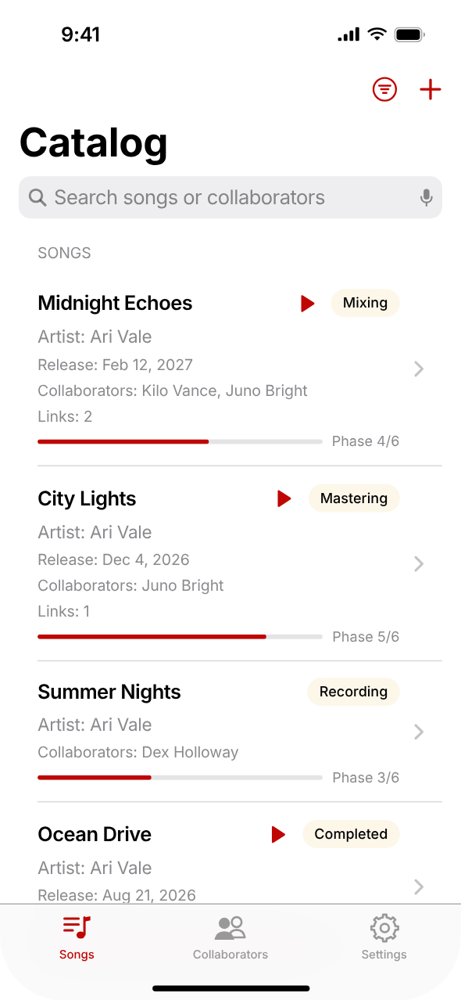
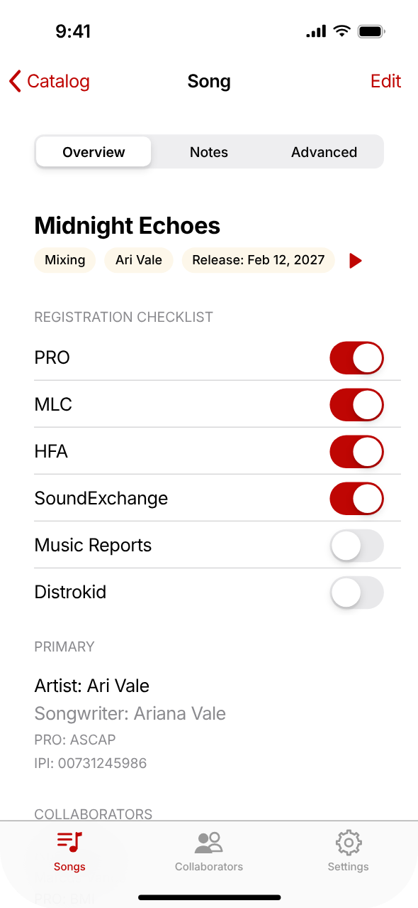
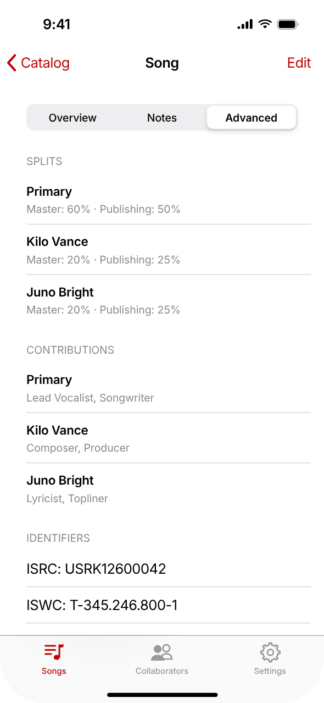
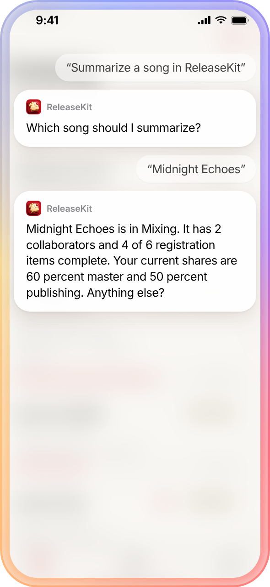

# ReleaseKit — Song Manager

ReleaseKit is a SwiftUI iPhone app for independent musicians that tracks every song, its collaborators, splits, and registrations — from first idea to release.

<p align="center">
  
</p>

<p align="center"><a href=".github/media/demo.mp4">▶ Watch the full demo (MP4)</a></p>

<p align="center">
  
  
  
  
</p>

## Features

- **Song catalog** — move songs through six phases (Pending → Writing → Recording → Mixing → Mastering → Completed); search, sort, and filter by phase, registration, or collaborator; attach up to five links per song.
- **Collaborators, splits & credits** — master and publishing splits per collaborator, 22 contribution roles, default PRO and roles, plus ISRC / ISWC / UPC identifiers.
- **Registration checklist** — track PRO, MLC, HFA, SoundExchange, Music Reports, and distributor submission for every song.
- **Apple Music library import** — import song titles from your library and play linked tracks in-app.
- **Artist Education Hub** — 13 built-in guides on rights, royalties, collecting societies, splits, distributors, release timelines, and growth.
- **Siri & App Shortcuts** — add songs and collaborators, update splits, walk the checklist, check release readiness, and control playback by voice. Destructive actions require Face ID, Touch ID, or your passcode.
- **Private** — all data stays on device in Core Data; no account required.

## Tech stack

SwiftUI · Core Data · App Intents · MediaPlayer · [RevenueCat](https://github.com/RevenueCat/purchases-ios-spm)

## Requirements

- Xcode 26 or later
- iOS 17.6+ (iPhone)

## Getting started

```bash
git clone https://github.com/dqships/song-manager-ios.git
cd song-manager-ios
```

1. Create `secrets.xcconfig` in the repository root, next to `songmanager.xcodeproj` (it is git-ignored and required by the Xcode project):

   ```
   REVENUECAT_API_KEY = your_revenuecat_public_ios_key
   ```

   Without a key, Debug builds stop at an assertion on launch — use any non-empty placeholder value to run without purchases.

2. Open the project:

   ```bash
   open songmanager.xcodeproj
   ```

3. Under **Signing & Capabilities**, select your own team and change the bundle identifier (`com.example.songmanager`) to one you own.
4. Build and run the `songmanager` target.

Before shipping your own build, replace the placeholder contact emails (`support@example.com`, `privacy@example.com`, `legal@example.com`) in the app.

## Tests

The Siri parsing and workflow logic has standalone test runners that compile with `swiftc` (macOS):

```bash
zsh Tests/SiriWorkflowTests/run.sh
```

## License

[MIT](LICENSE) © 2026 DaQuan Louden
